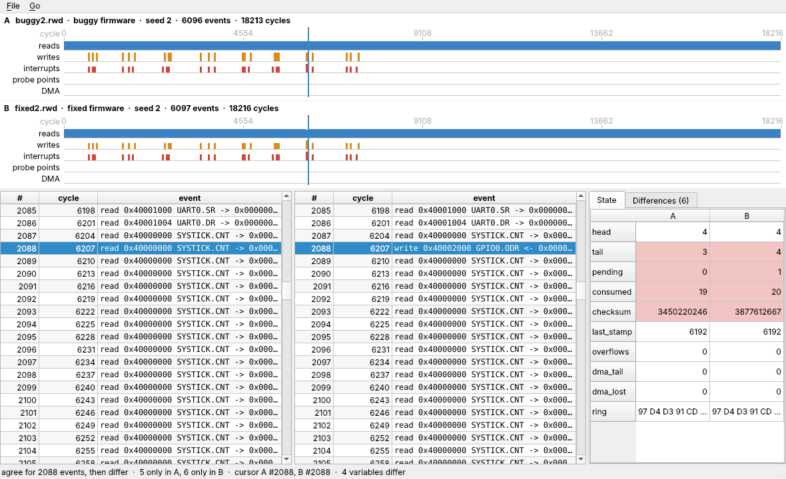

# rewind-mcu

[](https://github.com/juanlumc1988/rewind-mcu/actions/workflows/ci.yml)

Deterministic record & replay for bare-metal firmware. The command it builds
is `rewind`.

Record what crosses the hardware boundary on a device; replay it bit-for-bit
on your workstation, with no hardware and no simulator involved. A failure
that happens once a week in the field becomes a file you can reproduce on
demand.

**Status: 1.0.** Recording, replay, reverse execution, trace comparison and a
viewer work end to end, on the example firmware and on a firmware of your own
(see [Your own firmware](#your-own-firmware)). The device-side path — ring
buffer, drain loop, cycle-counter extension, Cortex-M backend — is written,
cross-compiles to a Cortex-M4 on every push, and is tested on the host, with its
interrupt trampoline run on an emulated Cortex-M4.

**It has never run on real silicon.** 1.0 means the host side is complete and
tested and the interfaces are settled; it does not mean the device side has been
proven on a part. That is the gap that matters, and it is not a small one: see
[What this does not do yet](#what-this-does-not-do-yet) before relying on any
of this.

## The problem

Most of the time spent debugging firmware goes on bugs that will not
reproduce: a race with an ISR, a peripheral that answers a few cycles later
than usual, a watchdog that fires once every three days at a customer's site.
The existing tools — SystemView, Tracealyzer, ITM/SWO — are *observation*
traces. They tell you what happened. They do not let you run it again.

## The idea

Bare-metal firmware is a deterministic function of its inputs, and those
inputs are a small, enumerable set:

1. reads of peripheral registers,
2. interrupt arrivals (which vector, at which cycle),
3. blocks DMA deposits in RAM,
4. reads of the clock.

Record those at the boundary between the firmware and the hardware, and the
same source, recompiled for the host, re-executes identically. Mozilla's `rr`
does this for x86 userspace; nothing open-source does it for a microcontroller.

## Demo

Run the example firmware under a thousand different interrupt-arrival
schedules and count how many fail:

```console
$ rewind hunt --from 1 --to 1000 --save bug.rwd
seed 2        FAIL  consumed 23 of 24 bytes  (32073 byte trace)

419 of 1000 runs failed (41.9%)
wrote the seed 2 failure to bug.rwd -- it now fails identically, every time:
  rewind replay bug.rwd
```

Forty-two percent. Miss it in testing and it ships. But the failing run is
now a 32 KB file, and that file is deterministic:

```console
$ rewind replay bug.rwd
replayed 6095 of 6096 events -- no simulator, no hardware
consumed 23 bytes  checksum 0x1EEC8173  state hash 0x3D74C29F6958D8CC
```

Every time. Then find out why:

```console
$ rewind dump bug.rwd
      6186  read   0x40001000 UART0.SR      0x00000003
      6189  read   0x40001004 UART0.DR      0x000000D3   <- ISR takes byte 19
      6192  read   0x40000000 SYSTICK.CNT   0x00001830
      6195  write  0x40002000 GPIO0.ODR     0x00000013   <- main loop drains it
      6195  irq    vector 1   UART_RX                    <- byte 20 lands HERE
      6198  read   0x40001000 UART0.SR      0x00000003
      6201  read   0x40001004 UART0.DR      0x00000091   <- and is buffered
      6204  read   0x40000000 SYSTICK.CNT   0x0000183C   <- ...then idle. Why?
```

The interrupt arrived *inside* the drain loop. The next line of firmware is
`pending = 0` — clearing a counter the ISR had just incremented — so byte 20
sits in the ring buffer and the main loop goes back to idling. One line, in
[`firmware/src/rx_pump.cpp`](firmware/src/rx_pump.cpp):

```cpp
g_state.pending = 0;       // BUG: erases anything the ISR added
                           // while the drain loop was running
g_state.pending -= n;      // what it should be, under a critical section
```

## Going backwards

Replay is deterministic, so the state at event N is a pure function of the
trace and N. Going backwards is therefore not undoing anything — it is
re-executing to an earlier point. Checkpoints make that affordable.

Take the failure above. The firmware consumed 23 bytes of 24, and we want
the moment it lost one. Bisect to when it had consumed 19:

```console
$ rewind inspect bug.rwd --find-consumed 19
6095 events, 47 checkpoints
first consumed 19 bytes at event 2083, found in 15 seeks
```

Fifteen seeks over six thousand events. Now step backwards through it:

```console
$ rewind inspect bug.rwd --at 2092 --walk 10
    event      cycle     iter   pending  consumed   head   tail
     2092       6216     2012         0        19      4      3
     2091       6213     2011         0        19      4      3
     2090       6210     2010         0        19      4      3
     2089       6207     2009         0        19      4      3
     2088       6204     2008         0        19      4      3   <-- pending = 0
     2087       6201     2007         2        19      4      3   <-- ISR made it 2
     2086       6198     2007         1        19      3      3
     2085       6195     2007         1        19      3      3
     2083       6192     2007         1        19      3      3
     2082       6189     2006         1        18      3      2
```

Read it upwards, the way time runs. At event 2087 `pending` is 2 — the ISR
has just taken byte 20 and incremented it. At 2088 it is 0, because the main
loop reached `pending = 0` and erased that increment. From there on `head` is
4 and `tail` is 3 forever: a byte sits in the ring that nothing will ever
consume.

That is the entire bug, in two consecutive lines, with the mechanism visible
rather than inferred.

### Why not fork()

`rr` and UndoDB checkpoint with `fork()`, because the state of a general
Linux process is large, opaque, and full of things you cannot copy by hand.
Copy-on-write is the only affordable way to snapshot it.

None of that applies here. The entire state of the system under replay is the
firmware's static storage, the replay cursor, and the shim's own handful of
scalars — no heap, no dynamic objects, nothing hidden. A checkpoint is a
struct copy of a few dozen bytes: faster than `fork()`, portable off Linux,
and debuggable.

That is not a shortcut around the hard problem. It is the hard problem being
genuinely easier in this domain. Bare-metal firmware has no private state by
construction, which is exactly the property that makes reverse execution
cheap here and expensive everywhere else.

What a struct copy cannot capture is the call stack, so checkpoints are taken
between main-loop iterations, where no call is in progress and the interrupt
mask is balanced. Landing on an exact event means replaying forward from the
nearest checkpoint and snapshotting at the instant that event is about to be
served.

The saving is measurable rather than asserted — `--checkpoints` sets the
interval, so you can watch it disappear:

```console
$ rewind inspect bug.rwd --at 2092 --walk 10
7150 events replayed to produce that.

$ rewind inspect bug.rwd --at 2092 --walk 10 --checkpoints 1000000
29062 events replayed to produce that.
```

## Comparing two runs

Two traces from different runs never match byte for byte, but the question
worth asking is where two runs that should have behaved alike stop doing so.
`rewind diff` aligns them, so what they share is paired off and what is left is
what only one of them did, and shows the first place they part with the
firmware's state in each:

```console
$ rewind record --seed 2 --variant buggy --out buggy.rwd
$ rewind record --seed 2 --variant fixed --out fixed.rwd
$ rewind diff buggy.rwd fixed.rwd
6091 events in common, 5 only in A, 6 only in B

the first difference is at event 2088
      =   2086  read 0x40001004 UART0.DR -> 0x00000091
      =   2087  read 0x40000000 SYSTICK.CNT -> 0x0000183C
      A   2088  read 0x40000000 SYSTICK.CNT -> 0x0000183F
      B   2088  write 0x40002000 GPIO0.ODR <- 0x00000014

the firmware's state just before it
                        A            B
        tail            3            4
     pending            0            1
    consumed           19           20
    checksum   3450220246   3877612667
```

The same seed, so the same interrupts arrive, and the two runs agree for 2088
events. Then the fixed one drains byte 20 and the buggy one goes back to
idling, because `pending` is 0 where it should be 1. That is the bug in
[Going backwards](#going-backwards), found by a comparison instead of a walk.

What counts as the same event is a choice. Timestamps are ignored unless
`--time` is given, and so is what the free-running counter read unless
`--strict` is, because it reads differently in every run and would make every
read of it a difference. The alignment is a shortest edit script and is capped:
past a point it is still a valid alignment but says it is not the shortest.
It exits 0 if the traces are the same and 1 if not, like `diff(1)`.

## The viewer

`rewind-gui` shows the same two things as a window: one trace, or two side by
side. It is a Qt 6 program and optional, so everything above works without it.



*A real render of the window, made headlessly with `--screenshot`, on the two
traces from [Comparing two runs](#comparing-two-runs).*

Each trace is a timeline with a row per kind of event (reads, writes,
interrupts, probe points, DMA) and below it the events as a list. The wheel
zooms about the pointer, dragging pans, a click puts the cursor on the event
under it, a double click shows the whole run again, and the arrow keys step
(Shift for ten). With two traces open, moving the cursor in one moves it to the
same moment in the other, by the alignment `rewind diff` computes; events only
one run has are tinted in the lists, and the *Differences* tab lists each place
the runs part (`Ctrl+D` goes to the first, `F3` and `Shift+F3` walk them). The
*State* tab is the firmware's variables at the cursor, one column per trace,
with the ones that differ tinted: in the picture, `pending` is 0 where it
should be 1: the lost update from [Going backwards](#going-backwards).

```console
$ rewind-gui buggy.rwd fixed.rwd --first-diff
$ rewind-gui bug.rwd --at 2092
$ rewind-gui buggy.rwd fixed.rwd --screenshot viewer.png   # no display needed
```

What the viewer draws and says comes from the same library the command line
uses (`host/`), without Qt, and that part has its own tests. The Qt part has
tests too, which drive the real widgets with the mouse, wheel and keyboard on
a window with no screen. The state column needs the firmware to be one this
build can run, as for `rewind inspect`; for any other trace the timeline and
the lists work and the variables show a dash.

## Your own firmware

Nothing in the tools is specific to the example. A firmware that reaches its
hardware through the shim (`mmio_read32`, `hal_set_isr`, ...) can be replayed,
walked backwards, compared and viewed by implementing one interface,
[`rwhost::Firmware`](host/include/rewind/firmware.h): how to start it, run some
iterations of its main loop, and save and restore its state.

```cpp
class Thermostat : public rwhost::Firmware {
public:
    void reset() override   { thermostat::reset(); }
    void install() override { thermostat::install(); }        // hal_set_isr, ...
    void run(u32 n) override { thermostat::run(n); }
    std::size_t state_size() const override { return sizeof(State); }
    void save_state(u8* out) const override;                  // memcpy the state
    void restore_state(const u8* in) override;
    // optional: describe_state() names the variables for the viewer and diff
};
```

[`examples/custom-firmware`](examples/custom-firmware) is a whole one: a
thermostat whose device code is C++98 against the shim, a model of its hardware
to run it against, that adapter, and a program that records it, replays the
file alone, walks the run (*when did the heater first switch three times?*) and
records from the middle, checking each step. CI builds that device code for a
Cortex-M4, against the installed device-side libraries, under the device's rules.

It builds inside this repository (`-DREWIND_BUILD_EXAMPLES=ON`) and, the way
your project would, against an installed package:

```console
cmake --install build --prefix /some/prefix
cmake -S examples/custom-firmware -B ex -DCMAKE_PREFIX_PATH=/some/prefix
```

```cmake
find_package(rewind 1 REQUIRED)       # any 1.x; another major is refused
target_link_libraries(my_device_code PRIVATE rewind::target)   # shim, recorder
target_link_libraries(my_host_tool   PRIVATE rewind::host)     # replay, timeline, diff
target_link_libraries(my_viewer      PRIVATE rewind::gui)      # if installed with it
```

Install from the cross-compiled build for the device-side libraries and from the
host build for the host ones; a cross build installs only what runs on the part.
The viewer is the same window as `rewind-gui`, told which firmware a trace is for:
`MainWindow::setFirmwareFactory`, `TraceDoc::set_firmware_factory`.

What the `rewind` command line does with a firmware that is not the example:
`dump`, `landings` and `diff` read any trace (`diff` compares the events of any
two; the state's variables it shows only for the example's, because a tool has to
be told which firmware a build id means -- yours links `TraceDoc` with its own
factory); `record`, `hunt`, `replay`, `inspect` and `locate` run the example
firmware, and for yours the same operations are
`record_firmware`, `replay_firmware`, `Timeline` and `locate_firmware` in
[`session.h`](host/include/rewind/session.h) and
[`timeline.h`](host/include/rewind/timeline.h). One thing to get right: the state
you save has to be *all* of it. A variable left out is one a checkpoint does not
restore, and the replay from that checkpoint then differs from the run.

## Architecture

Two worlds, kept apart by the build system rather than by discipline.

| Directory   | What                                          | Standard |
|-------------|-----------------------------------------------|----------|
| `core/`     | Trace format: varint, CRC-32, writer, reader, ring buffer | C++98 |
| `target/`   | HAL shim, recorder, cycle-counter extension, Cortex-M backend | C++98 |
| `sim/`      | A toy MCU: cycle counter, UART, GPIO           | C++98 |
| `firmware/` | Example firmware, in buggy and fixed variants  | C++98 |
| `host/`     | Replay engine, timeline, diff, the `Firmware` interface, CLI | C++17 |
| `gui/`      | `rewind-gui`, the Qt viewer (optional); 19 cases | C++17, Qt 6 |
| `examples/` | A thermostat: a firmware of one's own, built against the installed package | C++98 / C++17 |
| `tests/`    | 242 cases, 5.4 million assertions              | C++17 |

Everything that conceptually ships on the device is strict C++98 with no
heap, no exceptions and no RTTI, and CMake enforces it with
`-std=c++98 -pedantic-errors`. An `auto` in `core/` is a build failure, not a
code-review argument.

## Download

Each [release](https://github.com/juanlumc1988/rewind-mcu/releases) carries
built executables, with a `.sha256` beside each:

| File | What is in it |
|---|---|
| `rewind-<version>-linux-x86_64.tar.gz` | `rewind`, the command line, as one static executable: any x86-64 Linux, WSL2 included, nothing to install. And `rewind-gui`, the viewer, which needs Qt 6 (built on Ubuntu 24.04: `sudo apt install libqt6widgets6`). |
| `rewind-<version>-windows-x86_64.zip` | `rewind.exe`, the command line, as one static executable that needs nothing installed. There is no viewer for Windows; under WSL2 the Linux one opens a window. |

```console
$ sha256sum -c rewind-1.0.0-linux-x86_64.tar.gz.sha256
$ tar xzf rewind-1.0.0-linux-x86_64.tar.gz && cd rewind-1.0.0-linux-x86_64
$ ./rewind hunt --from 1 --to 100 --save bug.rwd
```

They are built in CI on every change (`binaries.yml`), not on the day of the
release, and attached by `release.yml`. The Windows one is cross-compiled with
MinGW; in CI its whole unit suite runs under Wine and the traces it writes are
compared byte for byte with the Linux build's. Nobody has run it on a Windows
machine yet, so it is the least proven of the two.

## Build and test

Needs CMake 3.16+, Ninja, and a C++17 compiler for the host side. No library
dependencies to install: doctest is vendored, and nothing else is used.

On Ubuntu/Debian, that's:

```console
sudo apt install cmake ninja-build g++
```

(`g++` pulls in the compiler; swap it for `clang` if you'd rather use Clang.
If you'd rather not install Ninja, drop `-G Ninja` below — CMake falls back
to Unix Makefiles, which `build-essential`/`g++` already provides `make`
for.)

```console
git clone https://github.com/juanlumc1988/rewind-mcu.git
cd rewind-mcu
cmake -S . -B build -G Ninja -DCMAKE_BUILD_TYPE=RelWithDebInfo
cmake --build build -j
./build/rewind_tests
ctest --test-dir build
```

CI runs this on GCC and Clang, in Debug and RelWithDebInfo, with warnings as
errors; separately under ASan and UBSan; separately again cross-compiled to a
Cortex-M4; again with the Cortex-M interrupt trampoline run on an emulated one
(see below); with the viewer built and its tests run on both compilers; and with
the package installed and a project of its own built against it.

Cross-compiling the libraries that would ship on the device needs the
`arm-none-eabi` toolchain (`sudo apt install gcc-arm-none-eabi` on
Ubuntu/Debian) — separate from the host compiler above, and not required
just to build and test on the host:

```console
cmake -S . -B build-arm -DCMAKE_TOOLCHAIN_FILE=cmake/arm-none-eabi.cmake \
      -DREWIND_BUILD_TESTS=OFF
cmake --build build-arm --target rewind_core rewind_target
```

To install it, so another project can `find_package(rewind)` (see
[Your own firmware](#your-own-firmware)):

```console
cmake --install build --prefix /some/prefix
```

The viewer is off by default, because it is the only part that needs Qt. With
Qt 6 Widgets installed (`sudo apt install qt6-base-dev` on Ubuntu/Debian):

```console
cmake -S . -B build -G Ninja -DCMAKE_BUILD_TYPE=RelWithDebInfo -DREWIND_BUILD_GUI=ON
cmake --build build -j
./build/rewind-gui a.rwd b.rwd
QT_QPA_PLATFORM=offscreen ctest --test-dir build   # the viewer's tests need no display
```

The Cortex-M interrupt trampoline is ARM assembly that reads the exception
frame the core pushes, which the host tests cannot run. With `qemu-system-arm`
installed, `tests/qemu/run.sh build-arm` runs it on an emulated Cortex-M4:
the return address it records must match, on the main stack and on the process
stack. It is an emulator, not a part, and says nothing about timing.

## How it works

The firmware never touches a register directly. It goes through
`mmio_read32` / `mmio_write32` and receives interrupts through the shim,
which runs in one of three modes:

| Mode | Backend | Records |
|------|---------|---------|
| `MODE_OFF` | real hardware | nothing — this is production |
| `MODE_RECORD` | real hardware | every input, appended to a trace |
| `MODE_REPLAY` | **a trace** | nothing |

The symmetry is the point. Record and replay run identical firmware down
identical code paths; the only difference is where the bytes come from. So
any deviation surfaces immediately as a mismatched address or an event out of
turn — a divergence, reported loudly:

```console
$ rewind replay bug.rwd --iters 12000
DIVERGED: read of 0x40000000 past the end of the recording
          (the recorded run stopped after 6095 events)
```

### Trace format

A 32-byte header, then CRC-checked, sequence-numbered blocks of varint-packed
events. Blocking means a trace cut short by a brown-out still yields every
whole block that made it out, and the reader stops cleanly at the ragged tail
instead of reporting garbage. The sequence number is what separates a *lost*
block from a *corrupt* one — see [Losing data honestly](#losing-data-honestly).

Timestamps and addresses are both stored as deltas. The address delta is
ZigZag-coded and matters more than it looks: `0x40000000` costs five bytes in
LEB128 *every time*, but firmware poke the same handful of registers over and
over, so the delta is usually zero and costs one. That single change took the
example trace from 9.2 bytes per event to **5.3** — on a device shipping
traces over a 115200 baud UART, the difference between viable and not.

The header carries a `build_id`. Replaying a trace against a different
firmware build is the fastest way to spend an afternoon chasing a bug that is
not there, so it is refused.

### Probe points

An interrupt can only be replayed where the shim runs, which is at a peripheral
access, so a race whose window is pure computation has nowhere to land. Mark the
window with `RWD_SITE(id)` and it becomes one more place the shim runs: the
crossing is recorded, replay checks it in order, and an interrupt recorded after
it is delivered there. A load-add-store with a probe point in it loses an update
on some simulator seeds and not others, and the seeds that lose one replay
from the trace alone and lose the same one (`tests/test_sites.cpp`). The
example firmware's `unguarded` variant uses one: it subtracts what it handled
without a critical section, a race with no register access in its window, and
`rewind hunt --variant unguarded` finds it (85 of 1000 seeds, against 419 for
`buggy` and none for `fixed`). A window with no probe point in it is still out
of reach, and `rewind landings FILE` says where that happened on a trace from a
part: for each interrupt, how many cycles after the last crossing it was taken,
and the return address to look the code up by.

A part will not record its probe points: they cost trace bytes and cycles, so
they are compiled out on the device, and the trace says only that an interrupt
came between two accesses. The host build keeps them, and they become
candidate places to deliver it. `rewind locate` tries each and keeps the one
the rest of the trace agrees with; `--no-sites` records a simulator run that
way, to try it:

```console
$ rewind hunt --variant unguarded --no-sites --save hw.rwd
85 of 1000 runs failed (8.5%)

$ rewind replay hw.rwd
DIVERGED: event 2253: firmware wrote 0x40002000, trace has MMIO_READ
This trace was recorded without its probe points, so an interrupt that landed
away from an MMIO access is replayed in the wrong place. `rewind locate`
searches for where.

$ rewind locate hw.rwd
24 interrupts to place in 6096 events; 51 replays of the firmware
...
   2244        6694    1  right after the crossing     1
   2249        6707    1  after 1 probe point          2
   2517        7508    1  right after the crossing     1
...
replay with these landings: reproduces the recording
consumed 23 bytes  checksum 0x4383D282  state hash 0x8B5B387DDA1B83D7
```

It recovers the one interrupt that landed in the window and reproduces the run
the simulator recorded, to the checksum. It can only choose among the probe
points the build has, and cannot tell apart landings the trace never shows; see
[`docs/design/execution-model.md`](docs/design/execution-model.md).

### DMA

A DMA controller writes RAM with no CPU involved, at times nothing on a part can
observe, so a trace cannot record the deposit. It can record the moment the
firmware looks. Firmware reads DMA buffers through the shim, the way it reads
registers, instead of dereferencing them:

```cpp
const u32 count = mmio_read32(DMA_COUNT);      // how many bytes have landed
hal_dma_read(RX_REGION, index, buf, n);        // and the bytes themselves
```

Each read is recorded with the bytes it saw (`EV_DMA`, in pieces of at most 16),
replay hands the same bytes back whatever memory holds now, and a read of another
region, offset or length is a divergence like any other. The firmware's look is
itself a crossing, so unlike an interrupt there is nothing to locate. A buffer is
named by id, registered by the firmware on the device
(`HardwareHal::add_dma_region`) and on the host, because a device address means
nothing on the host.

```console
$ rewind record --seed 5 --variant dma --out dma.rwd
uart delivered 24 bytes, firmware consumed 24
$ rewind dump dma.rwd | grep dma
       893  dma    region 0 +0    len 1   0D
      1039  dma    region 0 +1    len 1   20
      1197  dma    region 0 +2    len 1   76
```

The example firmware's `dma` variant receives the UART through a ring this way
and replays exactly. Its trace is larger than the others (about twice the
events) because it polls the count register every pass. The firmware has to
read DMA memory through `hal_dma_read`: a direct read of the buffer is not
recorded, and in replay it sees whatever the host buffer holds, which nothing
detects. That is the same discipline the model asks of registers, and it is
the price of not being able to see a DMA deposit. DMA that only *reads* RAM (a
transmit buffer) is output, not input, and needs nothing.

### Starting in the middle of a run

Replay re-executes the firmware, so it is only faithful from the state the
recording began in. From reset that is given. Keeping only the stretch before a
failure -- the lead-up is not worth the bytes -- needs that state in the trace.
The firmware says which parts of its RAM are its state, and the recorder writes
them ahead of the first event (trace format 6, `EV_RAM`):

```cpp
rwd::hal_state_region(0, &g_state, sizeof(g_state));   // once, at start-up
...                                                    // the firmware runs
recorder.start();
rwd::hal_snapshot();                                   // at a quiet point
```

Replay finds the image, hands it to `Firmware::restore_region` and starts after
it; the timeline's first checkpoint and `rewind locate` do the same, and walking
backwards ends at the image. With the example firmware:

```console
$ rewind record --seed 2 --iters 3000 --skip 3000 --out half.rwd
$ rewind dump half.rwd --limit 5
     cycle  what   addr       register      value
      9213  ram    region 0 +0    len 16  97D4D391FE526280069A0078CF302CE0
      ...
$ rewind replay half.rwd --iters 3000      # ends in the state the whole run did
```

`--iters` counts the recorded iterations, and replay takes the same. What it
costs: the size of the regions, plus about five bytes per sixteen, once -- it is
for state measured in tens of bytes, not a framebuffer. What it asks: take it
where the state is whole (between iterations of the main loop, not in a handler
or a critical section), and declare all of it, as above. The image is the
firmware's state, not the part's: the registers' contents come from the trace as
before.

### Interrupt priorities

By default one handler never interrupts another. Give the vectors priorities
(`hal_set_irq_priority`, Cortex-M style: smaller is more urgent) and, with a
backend that models them -- the simulator and replay do -- a handler's own
register accesses are where a more urgent interrupt is taken, at any depth. The
trace needs nothing new: the nesting is in the order of its events. Replay nests
the same way if the firmware sets the same priorities, and reports a divergence
if it does not. On a part the NVIC does the arbitrating; the firmware tells the
shim the numbers it programs into it, so a trace from the part replays with the
same nesting. Details in
[`docs/design/execution-model.md`](docs/design/execution-model.md).

## On the device

`Recorder` is what firmware instantiates. It owns a `TraceWriter`, a
`RingBuffer` and a `drain()` you call from the main loop's idle time:

```cpp
static rwd::Recorder recorder;
static rwd::u8 ring[4096];        // sized by `rewind sizing`, see below
static rwd::u8 block[256];

rwd::cortex_m::enable_cycle_counter();
rwd::hal_attach(hardware.ops());
recorder.begin(ring, sizeof(ring), block, sizeof(block),
               kBuildId, serial_number, rwd::kFlagRecordWrites);
recorder.start();

for (;;) {
    do_the_actual_work();
    recorder.drain(&uart_write, &uart, 256);
}
```

No allocation anywhere: both buffers are the caller's, sized at link time.

### What it costs in flash

Built for a Cortex-M4 at `-Os`, measured in CI on every push:

| Object | text (flash) | bss |
|---|---:|---:|
| `trace_writer.cpp` | 1676 | 0 |
| `hal.cpp` | 1361 | 113 |
| `ring_buffer.cpp` | 334 | 0 |
| `recorder.cpp` | 278 | 0 |
| `varint.cpp` | 166 | 0 |
| `crc32.cpp` | 140 | 0 |
| `cortex_m.cpp` | 406 | 0 |
| `clock.cpp` | 276 | 0 |
| **recording total** | **4637** | **113** |
| `trace_reader.cpp` | 2671 | 0 |

**Roughly 4.6 KB of flash and 117 bytes of RAM (.bss and .data) to record.** That
is the library as built, with everything in it: of the flash, 500 bytes is DMA
support (`TraceWriter::dma`, `hal_dma_read` and the device backend's region
table), 450 the memory image (`hal_state_region`, `hal_snapshot`,
`TraceWriter::ram`) and 60 setting a reference clock. Those are separate
functions: a firmware that uses none of them links none of them (a link of the
QEMU test program, which does not, has none of those symbols in it). The
priorities and the reference clock's arithmetic are in the totals above and are
not optional: about 180 bytes of the clock's are linked with `HardwareHal`
whether or not a reference is set. The reader is only linked in if the device
replays its own traces -- useful after a watchdog reset, and discarded by
`--gc-sections` otherwise.

CI also asserts that none of this pulls in `malloc`, `_Unwind`, `__cxa_throw`
or `typeinfo`. The claim that the target side has no heap, no exceptions and
no RTTI is checkable, so it is checked rather than reviewed.

Recording happens in whatever context touched the peripheral — main loop or
ISR — so a push can interrupt another push, and the sink masks interrupts
around it. The masked window is a bounded copy of at most one block, no loops
and no I/O.

### Losing data honestly

A device that records faster than its link can carry will eventually drop
something. The design decision that matters is what it does then.

Each block carries a sequence number. A refused block is counted, the
sequence still advances, and recording continues — so a burst that overruns
the buffer costs you that burst, not the rest of the run. When the trace is
later read, the gap is visible:

```console
$ rewind replay short-buffer.rwd
rewind: gap in trace: the device dropped blocks it could not drain in time
```

Rejected at load, before a single instruction of firmware runs. Without the
sequence number this trace would parse perfectly — every surviving block has
a valid CRC — and replay would diverge somewhere downstream, sending the
investigation at the firmware instead of at the buffer.

### Sizing the buffer

```console
$ rewind sizing --seed 7 --drain 512 --fifo 4
      ring  high water  blocks lost    bytes lost  verdict
       128          96          129         32535  LOSES DATA
       512         508           10          2525  LOSES DATA
      2048        1906            3           756  LOSES DATA
      4096        2593            0             0  ok
      8192        2593            0             0  ok

Smallest ring that loses nothing: 4096 bytes.
```

High water is peak occupancy. Once it stops climbing, the buffer is bigger
than the traffic needs and the rest is .bss you are paying for.

### Timestamps

`DWT->CYCCNT` is 32 bits and wraps every 25.6 seconds at 168 MHz.
`ClockExtender` widens it to the 64 the format expects, by the obvious method
— a reading lower than the last one means a wrap — which rests on being
sampled more often than once per period. Every recorded MMIO access is a
sample, so firmware that touches a peripheral even once a second has
twenty-five times the margin it needs.

Firmware that goes quiet for longer than a wrap period can still skip one,
and the counter alone cannot tell one wrap from two. That is fixed with a
second, slower clock -- an RTC, a low-power timer, a millisecond tick; any
free-running counter that does not itself wrap in the longest silence:

```cpp
hardware.set_reference_clock(&rtc_ticks, 0, 5127);   // a read; core cycles per tick
```

The counter says how far it moved modulo 2^32, the reference says roughly how
much time passed, and together they say how many whole periods went by. The
reference only has to be right to within half a period (12.8 seconds at 168 MHz):
a 32.768 kHz RTC is good to a few thousand cycles, and a crystal 200 ppm off
moves a six-period silence by about five million, a thousandth of a period. A
wrong calibration is not believed quietly: samples where the two disagree by
more than a quarter period are counted in `doubtful()`. Without a reference,
`suspicious()` still reports the doubt instead of hiding it.

## What this does not do yet

Stated plainly, because the gap between this and the pitch is real:

- **Nothing has run on silicon.** `cortex_m.cpp` compiles under the same
  strict rules as the rest and its register definitions come from the ARM
  documentation, but it has not been executed on a part. Reviewed, not tested.
- **Interrupt dispatch is the real gap.** On hardware the NVIC dispatches at
  any instruction boundary, so a real ISR announces itself. On replay there
  is no NVIC, so the shim dispatches — and it can only do so after an MMIO
  access. A trace recorded on silicon whose interrupt landed mid-computation
  has no replayable point to land on, and will be reported as a divergence
  rather than replayed wrongly. The first half of the fix is done: a vector
  entry declared with `RWD_CORTEX_M_ISR` records the return address from the
  exception frame (`EV_IRQ_AT`), and the trampoline has been run on an
  emulated Cortex-M4 (`tests/qemu`), though not on a part. The address belongs
  to the device build, so replay cannot stop on it; what it can stop on are
  probe points (`RWD_SITE`), which the simulator and replay honour and the
  example firmware's `unguarded` variant uses. `rewind landings` reports the
  interrupts that landed too far from any crossing, and `rewind locate`
  searches for where they landed in a trace recorded without probe points.
  None of it has been tried on a part. Handlers that preempt each other by
  priority are modelled, but only as far as the firmware reports its priorities
  to the shim; masking is all-or-nothing, as PRIMASK is, with nothing like
  BASEPRI. See
  [`docs/design/execution-model.md`](docs/design/execution-model.md).
- **Reverse execution stops at iteration boundaries for checkpoints.** Seeks
  land on an exact event, but a checkpoint can only be taken where no call is
  in progress. Fine here; a firmware with a deeply nested main loop would
  want finer granularity, which needs the call stack captured too.
- **A state image is only as good as the firmware's declaration of it.** The
  recorder writes the regions the firmware named; a variable it left out is one
  a replay from the middle of a run does not have, and the replay then diverges
  for a reason that looks like a firmware bug. Nothing here can see a variable
  that was not declared.
- **No transport.** `drain()` takes a function pointer and the tests feed it a
  simulated UART. No SWO, RTT or real UART driver ships here.
- **CPU overhead is unmeasured.** Flash cost is now measured in CI (3.7 KB to
  record), but the <2% runtime target is still a design goal with no number
  behind it. It cannot get one without a part to run on.

## Roadmap

1. Re-enter a handler where hardware actually did. The return address is
   recorded, probe points give replay places to stop, `rewind landings`
   reports where they were not dense enough, and `rewind locate` searches
   for the landing when the trace does not say. What is left is trying it on
   a part, and resuming the search from checkpoints for long recordings.
   This is what makes hardware traces replay.
2. Run it on a part: a UART or RTT transport, and a measured overhead number
   held in CI.
3. DMA events. Done: see [DMA](#dma).
4. Qt timeline and two-trace diffing. Done: see [The viewer](#the-viewer).
5. Firmware of one's own, an installable package, recordings that start
   mid-run, nested interrupts and a second clock for CYCCNT's wraps. Done in
   1.0: see [Your own firmware](#your-own-firmware),
   [Starting in the middle of a run](#starting-in-the-middle-of-a-run),
   [Interrupt priorities](#interrupt-priorities) and
   [Timestamps](#timestamps).

What 1.0 leaves, apart from items 1 and 2: finer checkpoints (a firmware with a
deeply nested main loop would want the call stack captured), and the exporter to
bitwise-bus, which waits on its capture format.

## Related projects

[bitwise-bus](https://github.com/juanlumc1988/bitwise-bus) infers undocumented
bus protocols from captures. It began as a design note in this repository
(`docs/ideas/bitwise.md`, still in the git history) and now lives on its own:
its CRC identification stage works and is released, and the rest of its
pipeline is designed and not written.

The two do not share code. They meet at data: the bytes a firmware reads from
a UART in a `rewind` trace are a capture, with cycle-accurate timing, and
bitwise-bus plans a neutral capture format that an exporter on this side could
feed. No such exporter exists here yet.

## License

Apache-2.0. See [LICENSE](LICENSE).
